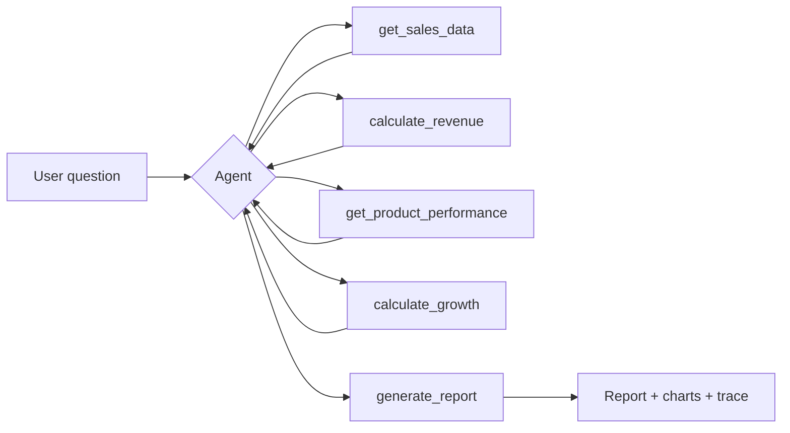

# 📊 Sales Intelligence Agent

A multi-step, tool-using AI agent that analyses sales data and writes a report, with **every step traced live** in a Streamlit UI.

Ask it something like:

> *"Analyse my sales performance this month and tell me which products are underperforming."*

The agent pulls the sales data, calculates revenue and growth, ranks products, flags underperformers, compares the current period with the previous one, and writes a report with recommendations. You can watch each tool call as it happens (inputs, outputs, timings and token counts) and download the full trace as JSON.

## Features

- **Real tool use:** in LLM mode the model decides which tools to call, with which arguments, and in what order.
- **Works with any LLM:** local (Ollama) or hosted (Anthropic, OpenAI, Gemini, Groq, any OpenAI-compatible server), through [LiteLLM](https://docs.litellm.ai/docs/providers).
- **Offline mode:** a fixed pipeline with rule-based findings, so the app runs with no LLM at all.
- **Live execution trace:** every model call and tool call shown as it happens, exportable as JSON.
- **Numbers you can trust:** report figures always come from tool results (pandas), never from the model's own text.
- **Built for small local models:** error recovery, argument cleanup and a guaranteed final report (see [below](#built-for-small-local-models)).
- **Bring your own data:** upload any CSV with the required columns.

## How it works



| Tool | What it does |
| --- | --- |
| `get_sales_data` | Retrieves records for a date range (optional category, region or product filter) and summarises them |
| `calculate_revenue` | Revenue, units, orders and average order value, optionally grouped by product, category, region or week |
| `get_product_performance` | Ranks products for the current period against the previous one and flags underperformers with reasons |
| `calculate_growth` | Revenue and unit growth %, overall or per product, category or region |
| `generate_report` | Builds the final Markdown report from the model's conclusions plus the exact tool numbers |

### Two modes

| Mode | How tools are chosen | Needs |
| --- | --- | --- |
| **LLM agent** | The model plans the tool calls itself | Any LLM supported by LiteLLM |
| **Offline pipeline** | Fixed order, rule-based findings and recommendations | Nothing |

The app switches to offline mode automatically when the configured local model isn't reachable.

## Quick start

Tested on Python 3.13.

```bash
git clone https://github.com/Vaibhav20414/sales-intel-agent.git
cd sales-intel-agent

python -m venv .venv
.venv\Scripts\activate             # macOS/Linux: source .venv/bin/activate
pip install -r requirements.txt

streamlit run app.py
```

On first launch the app generates sample data in `data/sales.csv`. You can also generate it yourself with `python data/generate_sample.py`.

### Using a local LLM (Ollama, the default)

1. Install [Ollama](https://ollama.com) and start it (the desktop app or `ollama serve`).
2. Pull a model that supports tool calling: `ollama pull qwen2.5:7b` (`llama3.1:8b` and `mistral-nemo` also work).
3. Run `streamlit run app.py`.

The sidebar shows whether Ollama is reachable and whether the selected model is installed.

### Using a hosted LLM

Copy `.env.example` to `.env`, then set the model and its key:

| Provider | `LLM_MODEL` | Key |
| --- | --- | --- |
| Ollama (local, default) | `ollama_chat/qwen2.5:7b` | none |
| Anthropic | `anthropic/claude-opus-5-5` | `ANTHROPIC_API_KEY` |
| OpenAI | `openai/gpt-4o-mini` | `OPENAI_API_KEY` |
| Google | `gemini/gemini-2.0-flash` | `GEMINI_API_KEY` |
| Any OpenAI-compatible server | `openai/<model>` + `LLM_API_BASE` | depends on the server |

You can also choose or type a model string in the sidebar. `.env` is gitignored, so your keys stay local.

### Configuration

| Variable | Default | Purpose |
| --- | --- | --- |
| `LLM_MODEL` | `ollama_chat/qwen2.5:7b` | Any LiteLLM model string |
| `OLLAMA_API_BASE` | `http://localhost:11434` | Ollama server URL |
| `LLM_API_BASE` | unset | Custom endpoint (vLLM, LM Studio, OpenRouter, ...) |
| `LLM_TEMPERATURE` | `0.1` | Sampling temperature |
| `LLM_MAX_ITERATIONS` | `12` | Maximum agent loop iterations (also adjustable in the UI) |

## Sample data

`data/generate_sample.py` produces a deterministic dataset (seed 42) covering 2026-08-01 to 2026-11-16, with a story planted in November so you can check that the agent finds it:

| Product | What happens from Nov 1 |
| --- | --- |
| Wireless Earbuds, Yoga Mat | Sharp drop in demand |
| Coffee Grinder | Heavy discounting plus lower demand, so revenue collapses |
| Desk Lamp | Price cut: units go **up**, revenue goes **down** |
| Smart Watch, Protein Powder | Strong growth |
| Everything else | Steady, with noise and a weekly pattern |

## Using your own data

Upload a CSV in the sidebar, or replace `data/sales.csv`.

- **Required columns:** `date, product_id, product_name, units, revenue`
- **Optional columns:** `order_id, category, region, unit_price, discount`

"Today" is taken to be the **latest date in the data**, so older datasets work as expected.

### Time periods

| Phrase in the question | Current period | Compared with |
| --- | --- | --- |
| "this month" (default) | Month to date | The same days of last month |
| "last month" | Last full month | The month before |
| "this week" | Week to date | The same days last week |
| "last N days" / "last week" | The last N (or 7) days | The N days before |

### How underperformance is defined

A product is flagged when any of these is true (thresholds are in [`sales_agent/tools.py`](sales_agent/tools.py)):

- revenue growth against the previous period is below **-15%**
- it is in the **bottom quartile** of revenue share and has not grown
- **units are up but revenue is down**, which points to price or discount erosion

## Built for small local models

The LLM loop ([`sales_agent/agent_llm.py`](sales_agent/agent_llm.py)) is designed so a 7B model can complete the task reliably:

- Flat tool parameters, short tool results, and a larger Ollama context window (`num_ctx=16384`).
- Invalid JSON, unknown tools and bad arguments go back to the model as errors, so it can correct itself.
- Unknown arguments are dropped, and each drop is recorded in the trace.
- Tool calls that a model writes as JSON text, instead of as real tool calls, are recovered.
- If the model stops without calling `generate_report`, the agent completes the analysis itself, so a run always ends with a report.

## Tests

```bash
pytest -q
```

The suite covers the tool arithmetic, period parsing, data validation, the planted sample-data story, the offline pipeline, and the LLM loop against a mocked model (including bad JSON, text-embedded tool calls, a model that never calls `generate_report`, and connection errors). No LLM or network access is needed.

## Project layout

```
sales_agent/
  tools.py          the 5 tools (pandas) + TOOL_REGISTRY
  schemas.py        tool definitions (OpenAI function format; LiteLLM converts them per provider)
  agent_llm.py      provider-agnostic tool-use loop
  agent_offline.py  fixed pipeline
  executor.py       runs a tool and emits trace events
  trace.py          TraceEvent / Tracer (JSON export to traces/)
  report.py         Markdown report + rule-based findings and recommendations
  periods.py        "this month" / "last 30 days" -> date ranges
  data.py           CSV loading and validation
  config.py         env / .env configuration
app.py              Streamlit UI
data/
  generate_sample.py  deterministic sample data with planted underperformers
tests/              tool math, the planted story, offline pipeline, mocked LLM loop
traces/             saved run traces (gitignored)
```
